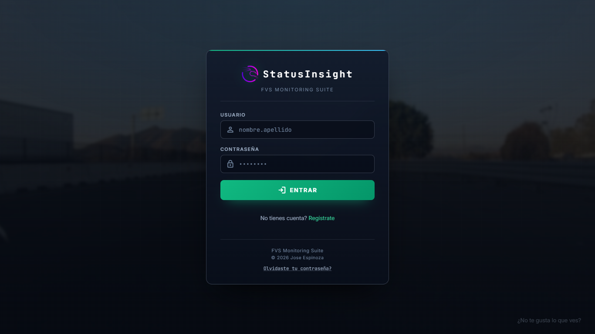
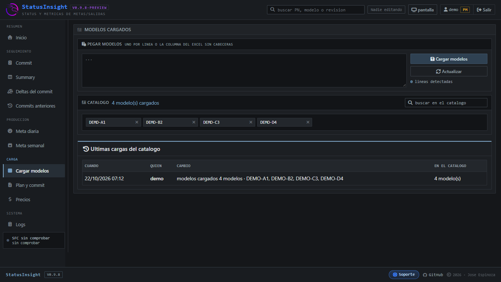
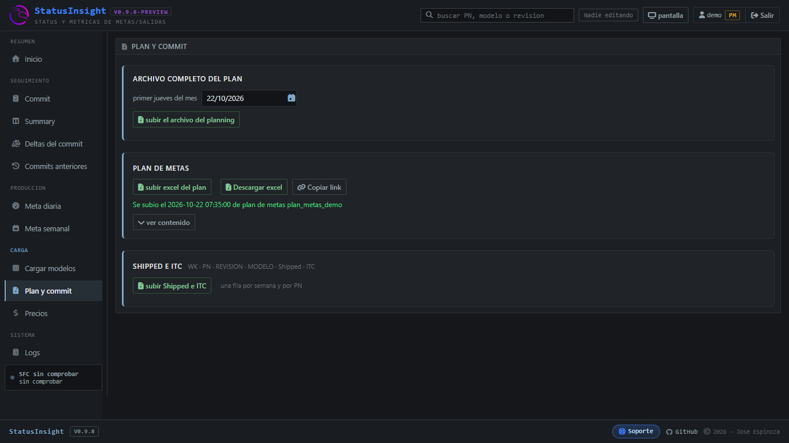
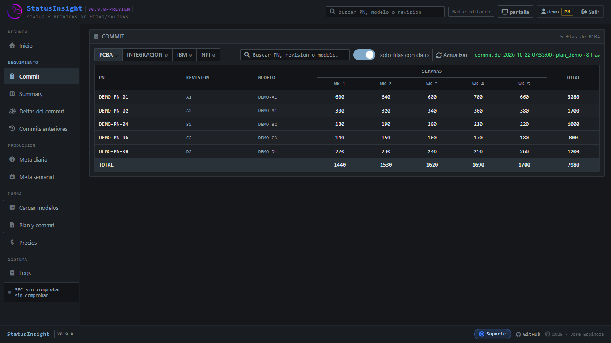
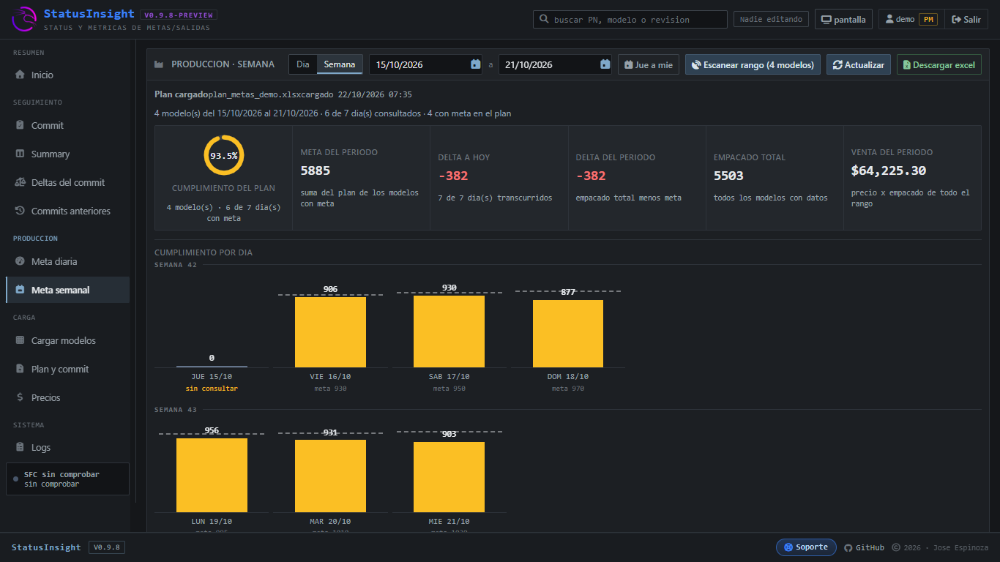
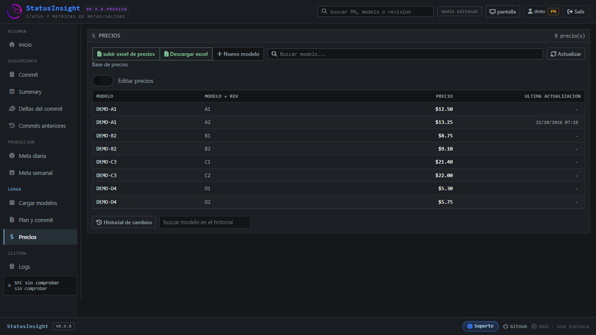
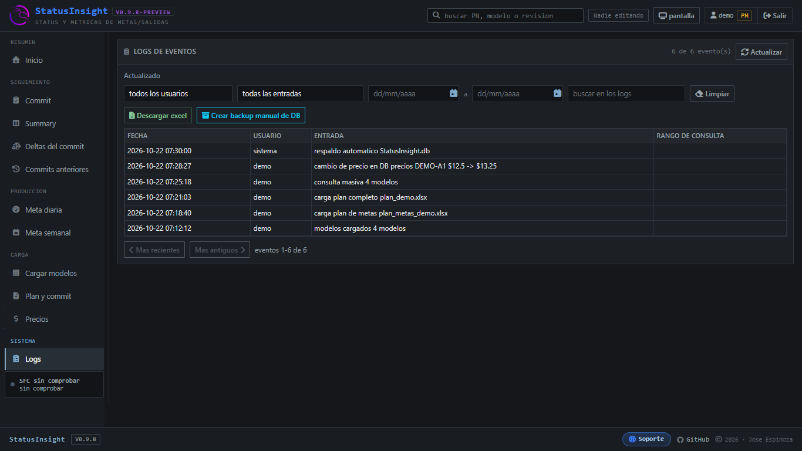
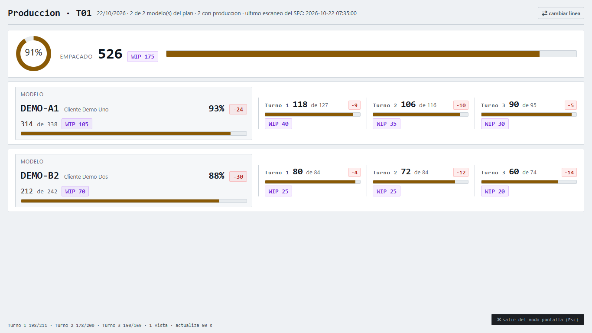

# Interfaz y funcionalidades

---

## Inicio de sesión

Acceso con usuario y contraseña. La cuenta la autoriza el administrador y su rol define los permisos con los que se entra al tablero.

  

---

## Cargar modelos

Catálogo de los modelos que se consultan, con el pegado de la lista, el conteo de renglones y el historial de cargas.

  

---

## Plan y commit

Carga del archivo completo del planning, del plan de metas y de las hojas de Shipped e ITC, con la fecha desde la que arranca la WK 1.

  

---

## Commit

El commit cargado, PN por PN y semana por semana, con sus cantidades y el total por renglón, filtrable por tipo de venta.

  

---

## Summary

El comprometido por tipo de venta y por semana, con las unidades y la ganancia, a partir del commit, el plan de salidas, los embarques y las unidades en almacén.

  

---

## Deltas del commit

El commit contra lo embarcado, PN por PN y semana por semana, con el delta en unidades y en ganancia y el faltante marcado en rojo.

  

---

## Meta diaria

Avance por turno de cada modelo contra su meta, con el cumplimiento y el delta del día, y el detalle del empacado por franja de 2 horas.

  

---

## Meta semanal

Rendimiento de un periodo por modelo, con el concentrado del periodo y el cumplimiento por día, por modelo y por turno.

  

---

## Precios

Base de precios por modelo y revisión, con el alta de un modelo nuevo, el buscador y el historial de los cambios hechos a mano.

  

---

## Logs

Bitácora de la aplicación: quién entró, qué consultó, qué cargó y cuándo, con filtros por usuario, por tipo de entrada y por fecha.

  

---

## Modo pantalla

Meta diaria de una sola línea del plan a pantalla completa, por turno y por modelo, con el empacado del día contra su meta, para dejarla fija en el piso.

  

---

  <a href="README.md">Volver al README principal</a>

