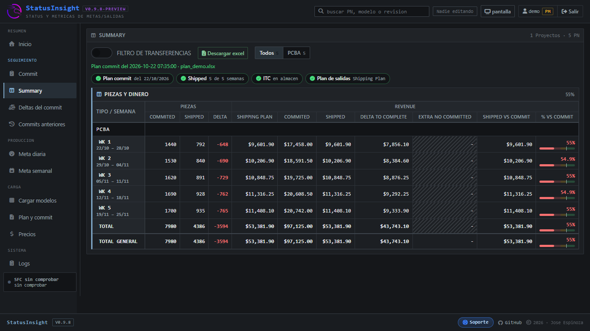
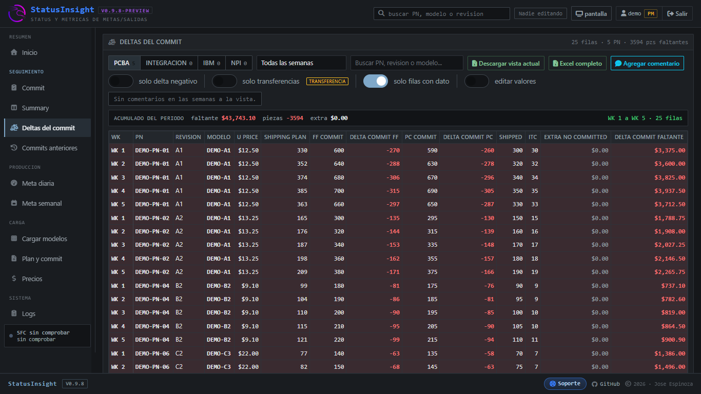

# StatusInsight

Aplicación web para el seguimiento de la productividad hora a hora, avance contra el plan de metas de producción y resumen de ventas por periodo. Genera automaticamente los reportes y obtiene la informacion de ShoopFloor, guarda el resultado del día y lo compara con el plan de metas por día, modelo y turno.

## Vistas

### Meta diaria

Avance por turno de cada modelo contra su meta, con el cumplimiento y el delta del día, y el detalle del empacado por franja de 2 horas.


### Meta semanal

Rendimiento de un periodo por modelo, el cumplimiento por día, por modelo y por turno.


### Summary

El comprometido por tipo de venta y por semana, con las unidades y la ganancia, a partir del commit, el plan de salidas, los embarques y unidades almacén.



### Deltas del commit

El commit contra lo embarcado, PN por PN y semana por semana, con el delta en unidades y en ganancia y el faltante marcado en rojo.



## Características

- Avance por turno: para cada modelo muestra lo empacado en cada turno contra su meta, con el cumplimiento y el delta del día.
- Empacado por hora: resumen hora por hora del día por modelo.
- Meta semanal: rendimiento de un periodo, con el concentrado, el cumplimiento por día, por modelo y por turno, y separados por modelo.
- Summary: el comprometido por tipo de venta y por semana, en unidades y en ganancia, con un interruptor para dejar fuera las transferencias entre plantas.
- Deltas del commit: el commit contra lo embarcado, PN por PN y semana por semana, con el delta en unidades y en ganancia.
- Plan de metas: se carga desde el Excel de planning (DIA / MODELO / TURNO / QTY META) y se usa de base de todas las vistas.
- Catálogo de modelos en el servidor: la lista se guarda una vez y alimenta todas las consultas.
- Logs: registra quién consultó qué y cuándo, y modificaciones que hayan realizado.
- Roles: Planner (consulta y captura) y produccion (solo consulta).
- Edición con candado: solo puede haber un editor a la vez, con aviso de quién esta editando actualmente la informacion.
- Exportación a Excel de lo que se está viendo y del periodo completo.

## Requisitos

- Python 3.9 o superior.
- Flask, Waitress, Requests, BeautifulSoup, openpyxl y cryptography.
- Acceso de red a las carpetas del sistema de producción.
- SQLite.

## Instalación y uso

1. Instala las dependencias.
2. Ejecuta la aplicación:

   ```
   python StatusInsight.py
   ```

## Roles

| Rol | Permisos |
| --- | --- |
| Planner | Consulta, carga el plan de metas y captura valores |
| produccion | Consulta el tablero completo, sin escribir |

## Estructura del proyecto

```text
StatusInsight/
├── StatusInsight.py      # servidor Flask y lógica del reporte
├── bases.py              # acceso a las bases SQLite
├── licencia.py           # verificación de la licencia de uso
├── templates/            # login y tablero
└── static/               # CSS, JS y fuentes
```

## Licencia

Software propietario de uso interno. El acceso requiere una licencia firmada.

## Autor

Alejandro Espinoza
Foxconn México
