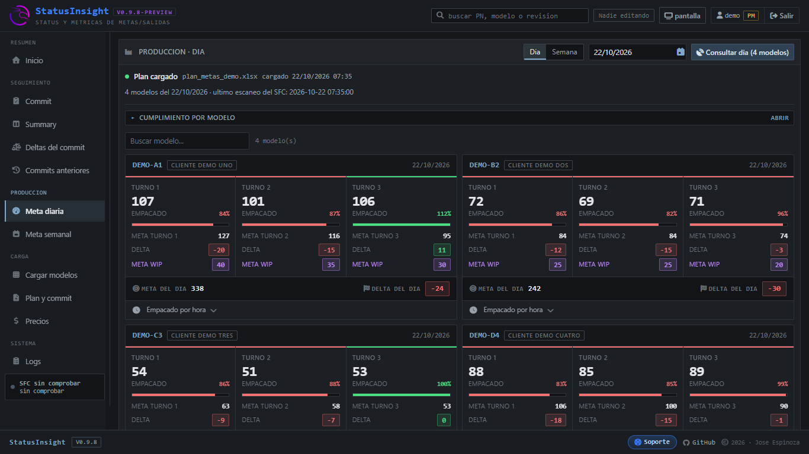

# StatusInsight

Aplicación web para el seguimiento de la productividad hora a hora, el avance contra el plan de metas de producción y el resumen de ventas por periodo. Obtiene la información de Shopfloor, guarda el resultado del día y lo compara con el plan de metas por día, modelo y turno.


- [Interfaz y funcionalidades](Funcionalidades.md)



## Origen del proyecto

StatusInsight nació como una vista dentro de FVS Monitor, dedicada al reporte horario de producción. Con el tiempo creció hasta separarse en su propia aplicación web, para que no cargara con el dashboard ni el dashboard con ella.

## Puesta en marcha

**Requisitos**

- Python 3.9 o superior.
- Flask, Waitress, Requests, BeautifulSoup, openpyxl y cryptography.
- Acceso de red a las carpetas del sistema de producción.
- SQLite.

**Instalación y uso**

1. Instala las dependencias.
2. Ejecuta la aplicación:

   ```
   python StatusInsight.py
   ```

3. Abre `http://<ip-de-la-maquina>:10004`.

**Acceso**

| Rol | Permisos |
| --- | --- |
| Planeador | Consulta, carga el plan de metas y captura valores |
| Producción | Consulta el tablero completo, sin escribir |

**Estructura del proyecto**

```text
StatusInsight/
├── StatusInsight.py      # servidor Flask y lógica del reporte
├── bases.py              # acceso a las bases SQLite
├── licencia.py           # verificación de la licencia de uso
├── templates/            # login y tablero
└── static/               # CSS, JS y fuentes
```

## Características

- Avance por turno: para cada modelo muestra lo empacado en cada turno contra su meta, con el cumplimiento y el delta del día.
- Empacado por hora: resumen hora por hora del día por modelo.
- Meta semanal: rendimiento de un periodo, con el concentrado, el cumplimiento por día, por modelo y por turno, y separados por modelo.
- Summary: el comprometido por tipo de venta y por semana, en unidades y en ganancia, con un interruptor para dejar fuera las transferencias entre plantas.
- Deltas del commit: el commit contra lo embarcado, PN por PN y semana por semana, con el delta en unidades y en ganancia.
- Plan de metas: se carga desde el Excel de planning (DIA / MODELO / TURNO / QTY META) y se usa de base de todas las vistas.
- Catálogo de modelos en el servidor: la lista se guarda una vez y alimenta todas las consultas.
- Logs: registra quién consultó qué y cuándo, y las modificaciones que se hayan realizado.
- Edición con candado: solo puede haber un editor a la vez, con aviso de quién está editando actualmente la información.
- Exportación a Excel de lo que se está viendo y del periodo completo.

## Autor

Alejandro Espinoza
Foxconn México
